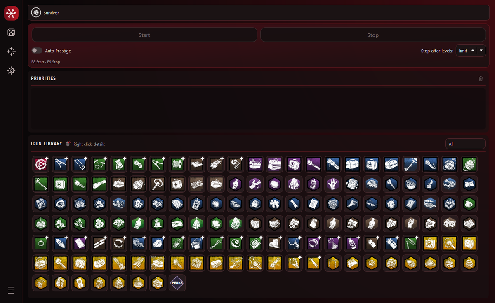
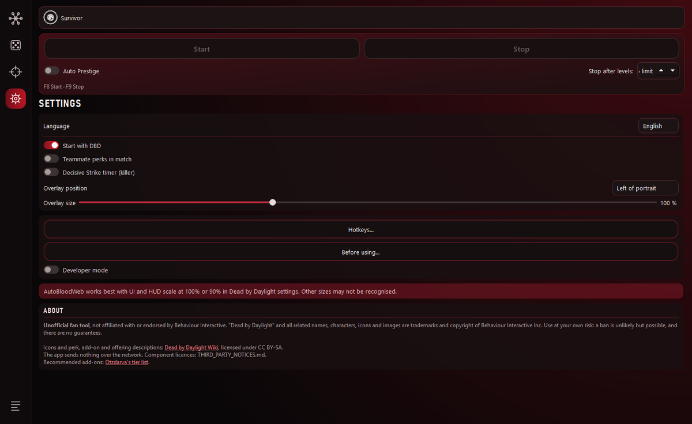
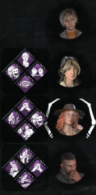
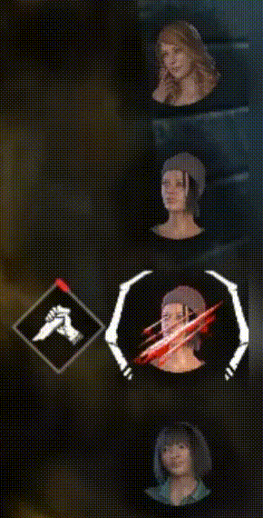

# AutoBloodWeb

AutoBloodWeb levels the Dead by Daylight Bloodweb for you. You pick the items, add-ons, offerings and perks you want, put them in order, press Start, and the app buys them in the Bloodweb by reading the screen and clicking like a player would. It also has a perk randomizer and optional in-match overlays.

> **Disclaimer.** Not affiliated with or endorsed by Behaviour Interactive. Dead by Daylight and its assets are trademarks of Behaviour Interactive. Use at your own risk: third-party tools may violate the game's rules.



## Features

- **Bloodweb automation** by your priority list, per character: items, add-ons, offerings, event items and "any perk". When nothing from your list is left, it completes the web so the next level comes.
- **Auto-buy of the centre** on levels 1–9, optional **Auto Prestige**, and **Stop after N levels**.
- **Icon library** of every item, add-on and offering, with descriptions on right-click; Otzdarva's recommended add-ons for killers.
- **Randomizer** for killer and survivor builds (perks, add-ons, offering), with exclusions.
- **Match overlays** (off by default): teammates' perks next to their HUD portraits after you press Tab, and a Decisive Strike timer for killers.
- **Crosshair** overlay (off by default).
- **Start with DBD**: an optional logon task that opens the app in the tray when the game starts.
- Five interface languages: English, Russian, Spanish, German, French.
- Works only with screen pixels and normal mouse clicks. It never reads or changes game memory or files and does not touch the anti-cheat. Nothing is sent over the network.



### Teammate perks overlay



*After you press Tab, each teammate's perks appear next to their HUD portrait.*

### Decisive Strike timer



*A red fill goes clockwise around after unhook while Decisive Strike can be active.*

## Requirements

- Windows 10 or Windows 11, 64-bit.
- **Run as administrator.** Dead by Daylight runs elevated, so the app needs the same rights to click in it. The installed app asks for this itself (UAC prompt).
- Dead by Daylight in **borderless** or **windowed fullscreen** mode.
- In-game **UI scale and HUD scale at 100% or 90%**. Other sizes may not be recognised.
- Tested at 1920×1080. Other resolutions are scaled and may be less accurate.

## Install

Download from the [Releases](../../releases) page. Check the file against `SHA256SUMS.txt` if you like:

```powershell
Get-FileHash .\AutoBloodWeb-1.0.0-setup.exe -Algorithm SHA256
```

- **Installer:** run `AutoBloodWeb-1.0.0-setup.exe`. It installs to `Program Files\AutoBloodWeb` and adds a Start menu shortcut.
- **Portable:** unzip `AutoBloodWeb-1.0.0-portable.zip` anywhere and run `AutoBloodWeb.exe` from the `AutoBloodWeb` folder. Keep the folder together: the exe needs the `assets`, `data`, `references` and `_internal` folders next to it.

The builds are not code-signed yet, so Windows SmartScreen may say "Windows protected your PC". Click **More info → Run anyway**, or build from source.

No Python is needed for the installer or the portable build.

## Usage

1. Start Dead by Daylight and open a character's Bloodweb.
2. Start AutoBloodWeb (accept the UAC prompt).
3. Pick the role and character, then click icons in the **Icon library** to add them to **Priorities**. Drag to reorder.
4. Press **Start** (or **F8**) and switch to the game within 3 seconds. Don't move the mouse while it works.
5. Press **F9** at any time to stop. The app also stops on its own when the game loses focus, a dialog it doesn't know appears, or it runs out of Bloodpoints.

Settings, priorities and logs are stored next to the app: `data\preferences.json` and the `debug\` folder.

## Hotkeys

| Key | Action |
|---|---|
| **F8** | Start / pause the Bloodweb run |
| **F9** | **Stop.** Always stops and releases the mouse button. Use it as the emergency stop. |
| **F10** | Show or hide the crosshair (only when the Crosshair page is enabled) |
| **Tab** (in game) | Read the scoreboard for the teammate-perk overlay |

F8 and F9 can be changed in **Settings → Hotkeys…**, the crosshair key on the **Crosshair** page.

## FAQ

**It doesn't find the Bloodweb or picks the wrong nodes.**
Check UI and HUD scale (100% or 90%), borderless or windowed fullscreen, and that nothing covers the Bloodweb, including this app's own window. Turn off ReShade, NVIDIA/AMD filters, HDR, colour mods and custom UI or texture mods: they change the pixels the app compares.

**Nothing happens when I press Start.**
Run the app as administrator. If the game runs elevated and the app doesn't, Windows blocks the clicks.

**Can I use another resolution or a second monitor?**
1920×1080 is tested. Other resolutions are scaled and usually work, but less accurately.

**Will it spend all my Bloodpoints?**
It spends Bloodpoints the same way you would by clicking. Use **Stop after N levels** and keep F9 at hand.

**Where are my settings? How do I reset them?**
`data\preferences.json` next to `AutoBloodWeb.exe`. Delete it to start fresh. The uninstaller removes it.

**Is it a virus?**
The builds are made with PyInstaller, which some antivirus engines flag by mistake. The source code is here; you can check the SHA-256 sums or build it yourself.

## Ban risk

Read this before you use it. Behaviour Interactive's EULA forbids automation and macro software, and **using AutoBloodWeb may violate the game's rules**. The app doesn't inject code or read memory, but that doesn't make it allowed. A ban is possible, but very unlikely unless you record gameplay with the Decisive Strike timer or use of autoleveling.

## Building from source

Python 3.15 on Windows.

```powershell
py -3.15 -m venv .venv
.venv\Scripts\python.exe -m pip install -r requirements.txt
.venv\Scripts\python.exe -m src.app --auto-elevate      # or run.cmd
.venv\Scripts\python.exe -m pytest                       # tests
```

Release build (needs [Inno Setup 6](https://jrsoftware.org/isinfo.php)): a separate environment with `opencv-python-headless` and `PySide6-Essentials` only.

```powershell
py -3.15 -m venv build\venv
build\venv\Scripts\python.exe -m pip install -r requirements-build.txt
build\venv\Scripts\python.exe -m pip uninstall -y opencv-python
build\venv\Scripts\python.exe -m pip install --no-deps --force-reinstall opencv-python-headless==5.0.0.93
build\venv\Scripts\python.exe scripts\build_release.py
```

The installer, portable zip and `SHA256SUMS.txt` appear in `build\release\`.

## Contributing and bug reports

Found a bug? In the app open **Settings → Report a bug…**: it opens the [issue form](../../issues/new/choose) and the folder with `app.log`. Check the log for personal info before you attach it. See [CONTRIBUTING.md](CONTRIBUTING.md) for pull requests and [SECURITY.md](SECURITY.md) for security problems. Everyone taking part follows the [Code of Conduct](CODE_OF_CONDUCT.md).

## License

AutoBloodWeb is released under the [MIT License](LICENSE). Bundled libraries, wiki data (CC BY-SA) and game images keep their own licences and ownership: see [THIRD_PARTY_NOTICES.md](THIRD_PARTY_NOTICES.md).

## Support the project

AutoBloodWeb is free and every feature stays free. If it saved you time, you can support development with a donation:

**USDT (TRC20 / Tron network only)**

```
TBgvqCy45eEcuazM32YY2vTDLvMBpPpK4W
```


Send only USDT on the Tron (TRC20) network. Other networks or tokens will be lost.
